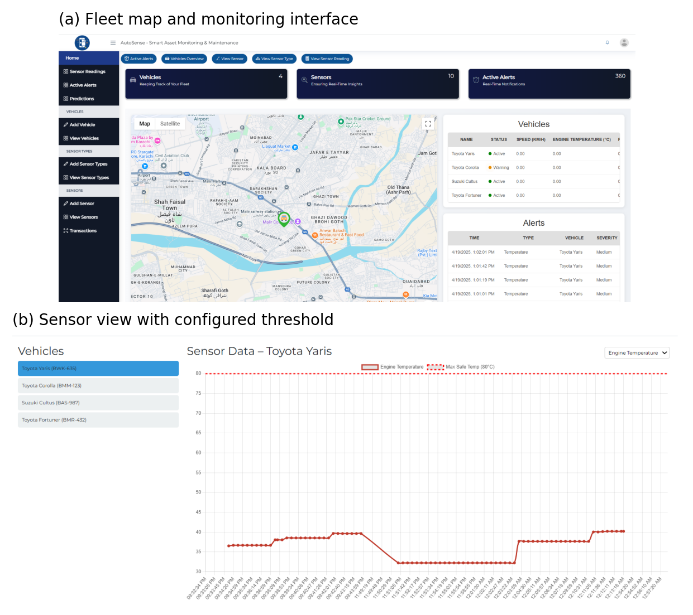
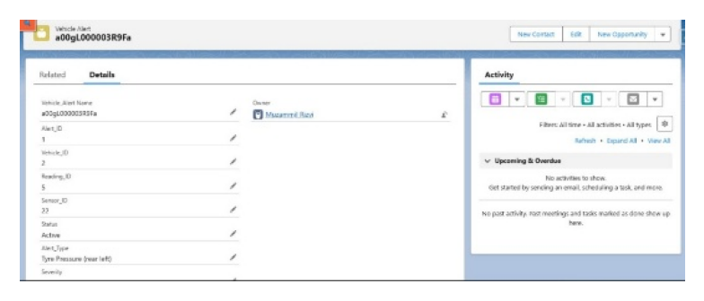
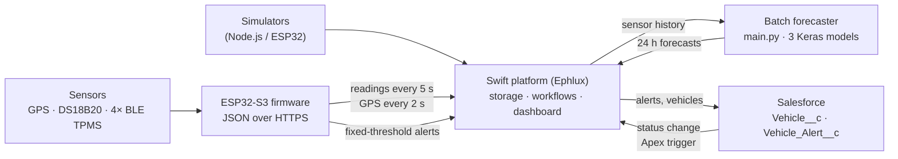
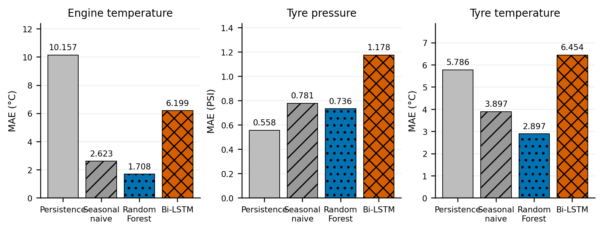

# AutoSense — Smart Asset Monitoring & Maintenance

AutoSense is a prototype vehicle-monitoring system built as an undergraduate final-year project at NED University of Engineering & Technology, Karachi. The project report calls it *Smart Asset Tracking and Predictive Maintenance System for Flight Catering*. It connects a custom ESP32-S3 sensor unit, a cloud monitoring dashboard, 24-hour sensor-reading forecasts, and Salesforce alert records into a single maintenance workflow.

This repository holds the prototype source (firmware, PCB, simulators, dashboard widgets, inference script, Salesforce Apex). It also holds a later re-evaluation of the forecasting models, published as a preprint on Zenodo ([DOI 10.5281/zenodo.22665260](https://doi.org/10.5281/zenodo.22665260)).

> **Scope in one sentence:** AutoSense forecasts future sensor readings (engine temperature, tyre pressure, tyre temperature) and compares readings and forecasts against fixed thresholds. It does **not** predict component failures or estimate remaining useful life, and it has not been evaluated on recorded fleet data.

## Prototype scope at a glance

| | What it covers | Evidence |
|---|---|---|
| **Physically built** | ESP32-S3 unit with NEO-6M GPS, one DS18B20 temperature probe and four BLE tyre-pressure (TPMS) sensors, mounted on one test vehicle. Custom PCB designed in KiCad. | Firmware, KiCad project, BOM; mounting reported by the team ([`Real Sensors.txt`](Real%20Sensors.txt)) |
| **Simulated** | Additional vehicles (random-walk readings for 4–5 vehicles) and all ML training data (synthetic 2024 time series) | [`Simulator/`](Simulator/), [`IoT/simulator/`](IoT/simulator/), generator notebooks |
| **Integrated** | Sensor unit → Swift platform (Ephlux) → dashboard; threshold alerts → Salesforce `Vehicle_Alert__c` records; Salesforce status change → Swift via Apex trigger; batch forecasts → Swift | Source code and interface screenshots below |
| **Evaluated** | Offline forecast accuracy on synthetic data and on the public NASA C-MAPSS FD001 simulator benchmark. No evaluation of maintenance outcomes. | [`research_v2/`](research_v2/) saved results |

## Screenshots

Fleet map, live alerts and per-sensor view on the Swift dashboard. The readings shown come from the prototype unit and the simulators:



An alert record created in Salesforce from a Swift alert:



PCB layout (KiCad 3D render; the CAN-bus and fuel-sensor headers were not used by the firmware):


There is also a project explainer video at [`Graphics/Explainer Video.mp4`](Graphics/Explainer%20Video.mp4), along with a [poster](Graphics/Poster.pdf) and a [brochure](Graphics/Brochure(1).pdf).

## Problem and intended users

AutoSense was designed for maintenance and fleet teams managing ground-support vehicles in flight-catering operations. The project explored how live condition monitoring and forecast-based alerts could supplement reactive or fixed-schedule maintenance. The project set out to give them live location and condition data, early warnings from forecasts, and a ticket-like record in Salesforce for each alert.

The project was reviewed with the team's industry advisor at Ephlux. The main feedback recorded was that the dashboard should be more intuitive. Claims in the project report about reduced downtime or maintenance cost were stated goals. They were never measured.

## Team and contributions

Final-year project, Department of Computer & Information Systems Engineering, NED University of Engineering & Technology (batch 2021–2025). Supervised by Dr. Shahab Tehzeeb, with industry advisor Nadeem Ali (Ephlux).

The table follows the signed *Statement of Contributions* in the [final report](Documents/3_Final-Report.pdf).

| Member | Contributions (from the final report) |
|---|---|
| **Muzammil Rizvi** | Sensor-data integration into the database; webhooks for real-time updates; Salesforce integration and Swift ↔ Salesforce sync; ticket and alert generation logic; ML model R&D, training and deployment |
| Wahaj Raza | Real-time dashboard graphs; alerts and notification system in Swift; ML model R&D and training; deployment-ready model pipeline; database schema; middleware–DB–frontend integration |
| Huzaifa Naseer Khan | ESP32 firmware; sensor integration and hardware assembly; Google Maps integration; readings and alerts tables; mock sensor-data simulation |
| Farrukh Niaz | Sensor and ML research; alerts widget; data-forwarding checks; view and entry forms; input validation; flow diagrams; documentation |

**Post-project re-evaluation (2026).** Muzammil Rizvi audited the original ML results and rebuilt the evaluation protocol in [`research_v2/`](research_v2/). This covered the corrected benchmark, multi-seed and ablation runs, C-MAPSS external evaluation, and preparation of the manuscript. All four team members are co-authors of the resulting preprint.

**Repository history.** The project-era commits (April–June 2025) were made in [HuzaifaNaseer02/AutoSense---Smart-Asset-Monitoring-Maintenance](https://github.com/HuzaifaNaseer02/AutoSense---Smart-Asset-Monitoring-Maintenance) and merged here. This repository is the maintained copy and includes the 2026 re-evaluation.

## System architecture and data flow



There are two separate alert paths:

1. **Reading-based alerts** run on the device. The firmware compares each reading with fixed limits: tyre pressure > 32 or ≤ 25 PSI, probe temperature ≥ 80 °C.
2. **Forecast-based alerts** run in the dashboard widget [`PredictedVehicleAlerts.js`](Custom%20Components/In%20Prod/PredictedVehicleAlerts.js). It applies a different set of fixed limits (engine > 95 °C, tyre temperature > 70 °C, pressure < 28 PSI) to the model forecasts.

In both paths the alert itself comes from a threshold rule. The ML models only produce the forecast values that the second rule checks.

## Implemented components

| Folder | Contents | Notes |
|---|---|---|
| [`IoT/hardware/FINAL_ESP32_FIRMWARE/`](IoT/hardware/FINAL_ESP32_FIRMWARE/) | Final Arduino firmware: Wi-Fi with NTP time, GPS over UART, DS18B20 over OneWire, BLE TPMS decoding by MAC address, HTTP POST of readings and alerts | Other sketches in `IoT/hardware/` are earlier single-sensor tests |
| [`IoT/PCB/`](IoT/PCB/) | KiCad schematic and layout, STEP model, production files (BOM, positions, netlist) | See also [`IoT/PCB Schematic.pdf`](IoT/PCB%20Schematic.pdf) |
| [`Simulator/`](Simulator/), [`IoT/simulator/`](IoT/simulator/) | Node.js and ESP32 simulators that post random-walk readings and alerts for 4–5 vehicles | Used for multi-vehicle demos and testing |
| [`Custom Components/In Prod/`](Custom%20Components/In%20Prod/) | Five React widget bodies for the Swift dashboard: map, live sensor charts, status and alert charts, forecast charts, forecast alerts | Written for Swift's component editor. They have no imports and can't run on their own. |
| [`Models and scripts/`](Models%20and%20scripts/) | `main.py` batch pipeline: fetch readings from Swift → feature engineering → three Keras models → post forecasts to Swift. Includes the deployed models and scalers. | Prototype script, see limitations |
| [`FYP ML Training and Pipeline Code/`](FYP%20ML%20Training%20and%20Pipeline%20Code/) | Original data-generation, training and testing notebooks for the three models | Superseded as evaluation evidence by `research_v2/` |
| [`Salesforce/`](Salesforce/) | Salesforce DX project with three Apex classes (pull alerts and vehicles from Swift, push status back) and a `Vehicle__c` trigger | The custom-object metadata isn't in the repository |
| [`research_v2/`](research_v2/) | Corrected forecasting benchmark, audit of the original results, extended experiments, paper sources | Manuscript PDF: [`research_v2/paper/build/main.pdf`](research_v2/paper/build/main.pdf). See below |
| [`Documents/`](Documents/) | Proposal, final report, original paper draft, presentations | Some ML figures in these documents are superseded (see below) |

## Data sources and simulation

- **Training data is synthetic.** The three training series (Karachi engine temperature, hourly; tyre pressure and tyre temperature, 3-hourly; calendar year 2024) come from generator notebooks in this repository. [`research_v2/verify_generators.py`](research_v2/verify_generators.py) reproduces every timestamp and value of the committed CSVs. The files in [`Dataset/`](Dataset/) are also generated.
- **Live readings** came from the prototype unit and the simulators through Swift. They weren't kept as a dataset, so no model was trained or tested on recorded vehicle data.
- **External benchmark:** NASA C-MAPSS FD001, a public, simulator-generated turbofan-degradation dataset. It is used only to test the same forecasting setup on independent data. It is not vehicle data.

## ML methods and evaluation

**Task.** Multi-step forecasting of a single sensor's future values from its own history. Engine temperature uses 168 hourly inputs to forecast 24 hourly outputs; the tyre series use 56 three-hourly inputs to forecast 8 outputs. Both cover seven days of history and a 24-hour horizon. Models compared: persistence (last value), seasonal naive (same time yesterday), Random Forest, and a stacked Bi-LSTM (128/64/32 units).

**Protocol** ([`research_v2/protocol.py`](research_v2/protocol.py)):

- Chronological split of raw rows: 68% train, 12% validation, 20% test.
- A window is kept only if its whole target horizon lies inside one partition.
- Min-max scaling is fitted on training rows only.
- Training runs without shuffling, with early stopping on validation loss.
- Hyperparameters were not selected on test scores.

**Benchmark versus deployed prototype.** The results below describe the corrected offline evaluation in `research_v2/`. The integrated prototype uses the original 11-feature models stored in [`Models and scripts/model_scaler/`](Models%20and%20scripts/model_scaler/); those deployed models are not the re-trained benchmark models. These results therefore do not measure the forecasting performance of the deployed prototype.

**Test-set MAE, synthetic data, seed 42** (from [`research_v2/results/final_comparison.csv`](research_v2/results/final_comparison.csv)):

| Target | Persistence | Seasonal naive | Random Forest | Bi-LSTM |
|---|---:|---:|---:|---:|
| Engine temperature (°C) | 10.16 | 2.62 | **1.71** | 6.20 |
| Tyre pressure (PSI) | **0.56** | 0.78 | 0.74 | 1.18 |
| Tyre temperature (°C) | 5.79 | 3.90 | **2.90** | 6.45 |



**Main finding.** In this setting, simple baselines outperform the Bi-LSTM on all three targets. Across five training seeds, the Bi-LSTM test MAE was:

| Target | Mean test MAE ± standard deviation across seeds |
|---|---:|
| Engine temperature | 5.18 ± 0.66 °C |
| Tyre pressure | 1.26 ± 0.22 PSI |
| Tyre temperature | 5.73 ± 0.89 °C |

These statistics describe variation across training seeds, not confidence intervals for real-world performance. See the [multi-seed summary](research_v2/ieee_results/multiseed_summary.csv).

The Bi-LSTM also failed in the threshold-event test. Forecasts were scored against training-derived proxy thresholds, not real fault labels:

- On engine temperature and tyre pressure, it never predicted a threshold crossing (F1 = 0).
- On tyre temperature, it predicted a crossing for every window (false-positive rate 1.0).

Further experiments (architecture and feature ablations, block-bootstrap intervals, C-MAPSS forecasting and stage analysis) are documented in [`research_v2/IEEE_UPGRADE_REPORT.md`](research_v2/IEEE_UPGRADE_REPORT.md). The C-MAPSS work forecasts sensor readings only and does not estimate remaining useful life.

**Evaluation update.** The original project report and paper draft contain metrics that were superseded by the 2026 audit. Use the corrected benchmark results above when citing this work. The [evaluation audit](research_v2/AUDIT.md) documents the original reporting issues, their reconstruction and the revised protocol.

**Important caveats.**

- All AutoSense metrics come from synthetic series, and the test windows overlap, so their errors are not independent.

## Setup and demonstration

This is a collection of components, not a single application you can run with one command. Running the full pipeline needs access to the team's Swift workspace (an Ephlux platform), which isn't public. The code references the team's Swift workspace. To reproduce the integration, configure endpoints and credentials for a workspace you control.

**Firmware** ([`FINAL_ESP32_FIRMWARE.ino`](IoT/hardware/FINAL_ESP32_FIRMWARE/FINAL_ESP32_FIRMWARE.ino))

- Hardware: ESP32-S3-DevKitC-1, NEO-6M GPS on UART2 (RX 16 / TX 17, 9600 baud), DS18B20, and BLE TPMS sensors.
- Libraries: ESP32 Arduino core (WiFi, HTTPClient, BLE), OneWire, DallasTemperature, ArduinoJson, TinyGPS++.
- Before flashing, fill in the Wi-Fi credentials, Swift webhook keys and your own TPMS MAC addresses.

**Simulator**

```sh
cd Simulator
npm install axios
node all_four_simulator.js   # after replacing the YOUR_SWIFT_KEY_* placeholders
```

**Batch forecaster** ([`Models and scripts/main.py`](Models%20and%20scripts/main.py))

```sh
pip install -r "Models and scripts/requirements.txt"
```

Before running it:

- Set the `SWIFT_KEY_VEHICLES`, `SWIFT_KEY_SENSOR_READINGS`, `SWIFT_KEY_DELETE_PREDICTIONS` and `SWIFT_KEY_POST_PREDICTIONS` environment variables.
- Change the hard-coded `/root/FYP-Python-Script/model_scaler/` paths to point at `Models and scripts/model_scaler/`.

The script **deletes and replaces the forecasts stored in Swift**, so only run it against a workspace you control.

**Salesforce** ([`Salesforce/`](Salesforce/)). The Apex code expects these items, which you need to create before deploying (for example with `sf project deploy start`):

- custom objects `Vehicle__c` and `Vehicle_Alert__c` with the fields referenced in the classes
- a Remote Site Setting for the Swift host
- a way to schedule `AlertWebhookService.fetchAndStoreAlerts()` and `VehicleWebhookService.fetchAndStoreVehicles()`

**Forecasting benchmark** ([`research_v2/README.md`](research_v2/README.md)). Requires Python 3.11 and [`research_v2/requirements.txt`](research_v2/requirements.txt). Run from the repository root:

```sh
python -m unittest discover -s research_v2 -p test_protocol.py -v   # protocol tests
python research_v2/verify_generators.py                              # regenerate synthetic data and compare
python research_v2/bilstm_evaluation.py                              # full retrain; overwrites research_v2/results/
```

Full retraining runs on the CPU and takes a long time. The saved outputs in `research_v2/results/` and `research_v2/ieee_results/` can be inspected without rerunning anything.


## Citation

> M. Rizvi, W. Raza, H. Naseer, and F. Niaz, “Benchmarking Multi-Step Sensor Forecasting for Threshold-Based Predictive Maintenance: An Integrated IoT-to-Enterprise Framework,” preprint, Zenodo, 2026. doi:[10.5281/zenodo.22665260](https://doi.org/10.5281/zenodo.22665260)

## Acknowledgements

- Dr. Shahab Tehzeeb (project supervisor, NED University).
- Nadeem Ali and the team at Ephlux, for industry guidance and access to the Swift platform.
- The ESP32-S3 KiCad symbol and footprint in [`IoT/PCB/ESP32_S3_DEVKITC_1_N8R2 (1)/`](IoT/PCB/ESP32_S3_DEVKITC_1_N8R2%20(1)/) are third-party library files under their own [license](IoT/PCB/ESP32_S3_DEVKITC_1_N8R2%20(1)/License.txt).
- NASA C-MAPSS data: Saxena & Goebel (2008).

## License

The code is released under the MIT License. The preprint on Zenodo is licensed separately under CC BY 4.0.
